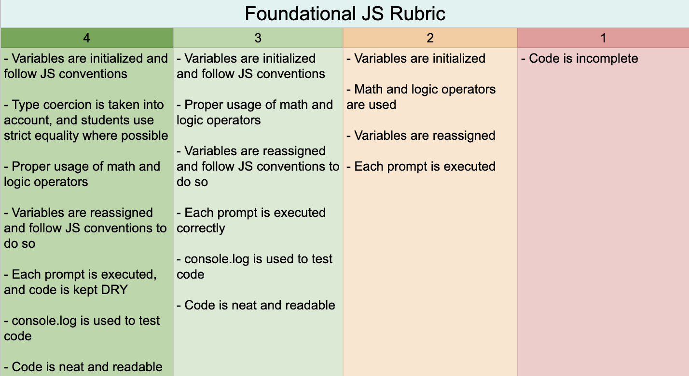
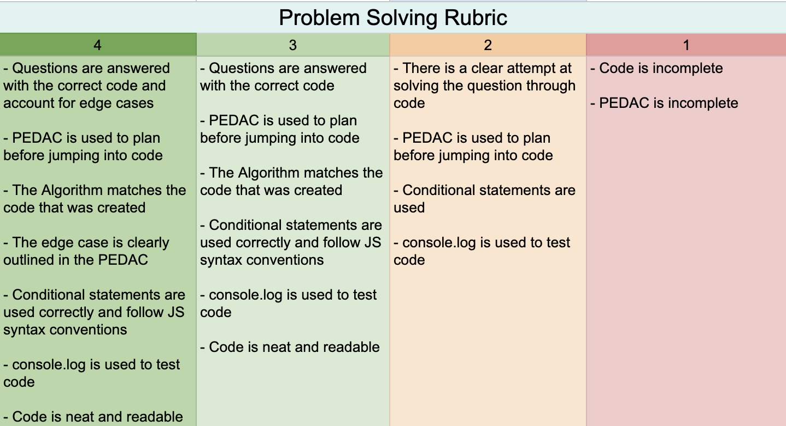
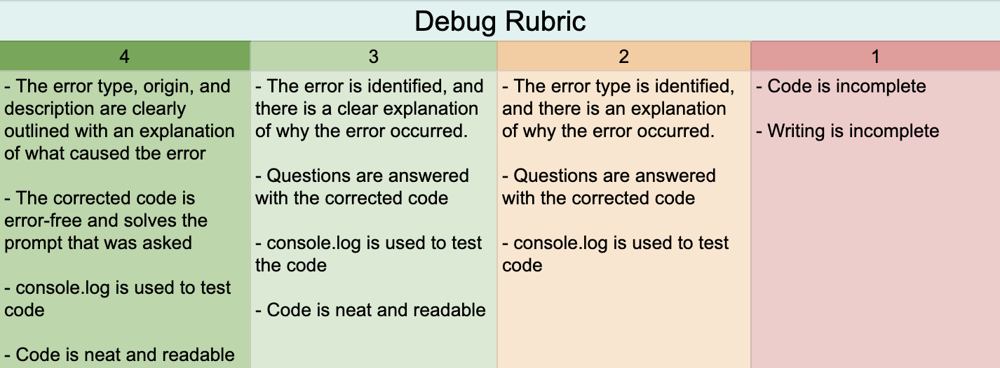

# T1-Assessment

Hey Team! This past trimester we have learned a lot! From Modulus to debugging but every step of the way you have all shown how capable you all are! This is an assessment but there is nothing on here that we haven't done already! You got this! 

Happy Coding!!!!

## Instructions:
There are 3 files besides this one! Go to each file and solve each question given. There is a playground file that is an empty js file in case you need it for the debug questions! Remember that you can and should use the `errorMessage` to help you answer the questions! 

### Foundational JS Rubric:



### Problem Solving Rubric: 



### Debug Rubric: 



## Resources
Remember to **_code a little, test a little_**; Use the following command to run your files: 

```node
node part-1-foundations.js
node part-2-problem-solving.js
node part-3-debug.js
node playground.js
```

You can use any and all resources given in the past including your notebook, our student drive and previous assignments from classmoji. 

## Community Note:

**_ANY USE OF AI WILL RESULT IN AN IMMEDIATE 0!_**